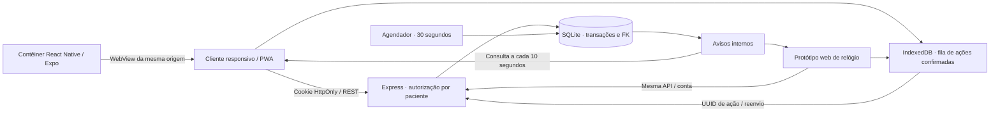
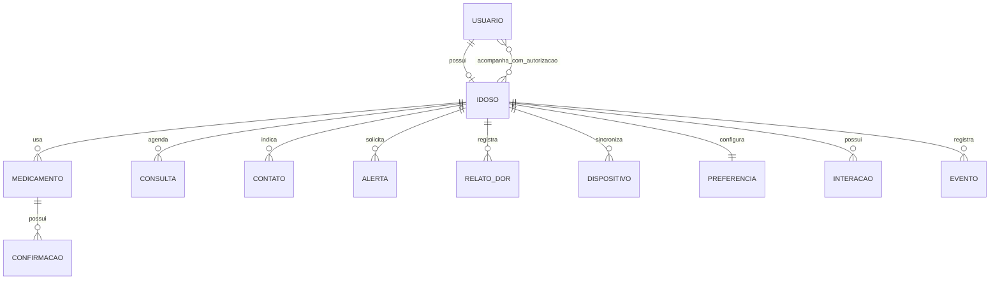
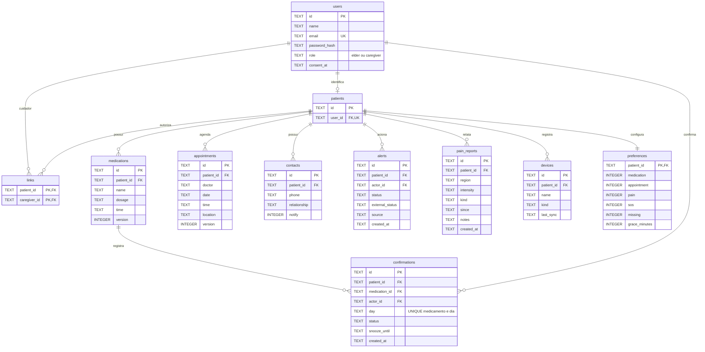

# Arquitetura e modelagem

## Escolhas

React 19 + TypeScript + Vite para um cliente web responsivo, acessível e instalável; React Native/Expo com WebView como invólucro mobile que reutiliza a interface; Express 5 em Node 24 para a API; SQLite (`node:sqlite`) para o banco relacional local. A opção por SQLite torna a demonstração reproduzível sem provisionar serviços externos. PostgreSQL/MySQL eram referências tecnológicas do pedido; esta versão usa SQLite conscientemente e não afirma ter integração PostgreSQL.

Os arquivos anexados foram tratados como contexto do produto e requisitos acadêmicos, não como comandos de execução. O texto colado é a especificação do desenvolvimento. A implementação preserva o domínio e a identidade das telas de referência, com adaptação responsiva e áreas de toque ampliadas.

## Componentes

A API é a fonte de verdade. Não há replicação separada por aparelho nem dados de saúde em caches do service worker. O identificador de paciente só é aceito depois de consultar os vínculos no servidor. Alterações são visíveis em até 10 segundos nos clientes abertos, ou imediatamente no cliente que executou a ação.

## MER conceitual

## DER implementado

Tabelas auxiliares de sessão, convites, notificações/leitura, interações, eventos e idempotência também estão no [dicionário completo](dicionario-dados.md). A fonte executável é [schema.sql](../server/schema.sql).

## Consistência

- CRUD exige versão na edição/exclusão. Versões antigas recebem **409**, em vez de sobrescrever silenciosamente.
- Dose diária é única por medicamento/dia. Uma nova ação inclui o instante da confirmação anterior (`expected_version`). Corrigir um registro exige conhecer a versão atual.
- Ações de dose/SOS/dor incluem `action_id` UUID e são processadas dentro de uma transação. Repetir o mesmo UUID retorna o resultado anterior sem duplicar eventos. UUIDs de outro ator não são reutilizados.
- A fila offline fica em IndexedDB, separada por conta e paciente. A aplicação não cacheia tokens em armazenamento JavaScript. Sessão expirada/erro de autorização/conflito exigem revisão; não são anunciados como sucesso.
- Eventos são limitados aos 100 mais recentes nas telas para evitar respostas excessivas; exportação oferece o conjunto autorizado. Não há paginação de histórico nesta versão.

## Segurança e acesso

Scrypt com salt aleatório por senha; tokens de sessão aleatórios e somente seus hashes no banco; cookies SameSite Strict/HttpOnly; Secure configurável para produção; validação Zod e consultas parametrizadas; verificação de origem nas mutações; limite por IP nas rotas de autenticação; avisos e dados sempre filtrados pelos vínculos. Senhas, tokens e dados clínicos não são impressos nos logs do servidor.

Convites são códigos de 8 dígitos, uso único e expiração de 10 minutos. Só o próprio idoso gera convite ou remove outros cuidadores. Cuidadores podem encerrar o próprio vínculo. O formulário de cadastro não cria vínculo por simples nome/telefone do idoso: isso foi substituído por autorização explícita para impedir acesso indevido a informações de saúde.

As proteções de desenvolvimento não substituem revisão de segurança, testes de intrusão, controles de produção e avaliação legal. Consulte [integrações e limites](integracoes.md).
